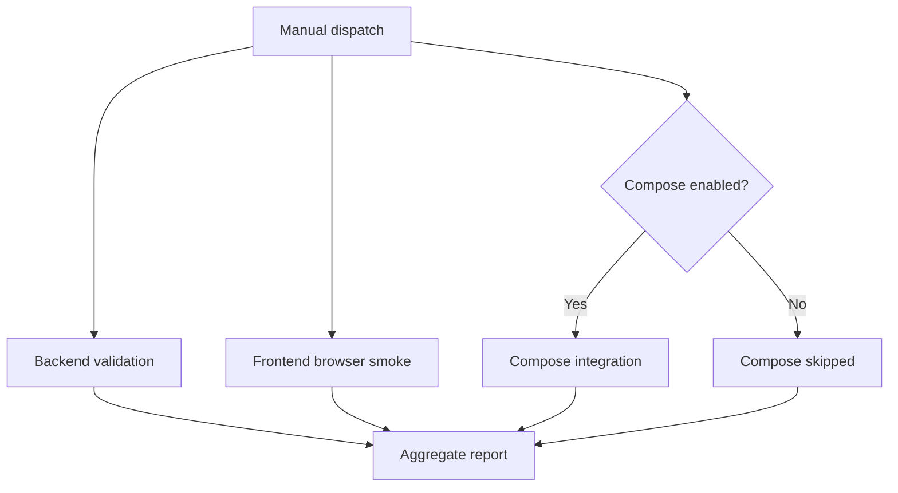

# Engineering Orchestrator — v0.1

**Status:** Initial implementation  
**Repository baseline:** `fix/ui-417-workspace-analytics-smoke` at `3e34aff19eceede6ab6a110f016ccd773307401f`  
**Execution entrypoint:** `.github/workflows/engineering-orchestrator.yml`

## Purpose

Provide one manually-triggered entrypoint that fans out independent engineering validation flows in parallel, then gathers their outcomes into one run summary. This removes the need to start backend, browser, and container validation workflows separately.

## Flow graph

- **Backend:** dependency installation, compile/configuration checks, frontend-ID checks, and the repository's unittest suite through `scripts/validate.sh`.
- **Browser:** pinned Playwright + Chromium desktop/mobile smoke; screenshots are retained as a workflow artifact.
- **Compose:** disposable encrypted-backup environment, service health/readiness checks, log collection, and teardown.
- **Report:** always runs and records each flow's terminal state, including failures and skipped Compose runs.

## Safety and resource controls

- Manual dispatch only; no recurring schedule and no automatic PR/push trigger.
- GitHub-hosted `ubuntu-24.04` runners; does not assume or alter the user's Windows self-hosted runner.
- Maximum three independent validation jobs by design.
- Read-only repository permission.
- No secrets, external provider credentials, publishing, deployment, PR merge, or branch mutation.
- Compose uses an ephemeral key and disposable volumes, then tears them down.
- A failed flow remains visible as failed; the report job does not convert failures into success.

## Current automation boundary

This is a **validation orchestrator**, not yet an autonomous coding agent. It automates parallel test/build execution and result aggregation. It does not invent or implement code tasks, create branches/PRs, resolve merge conflicts, or decide that a feature is production-ready.

Autonomous task implementation requires a separately authorized coding-agent runtime and credential boundary. No provider key or secret has been created or assumed. The safe next increment is to add a task manifest and agent adapter only after the execution provider, allowed repository scope, spend ceiling, and approval gates are defined.

## How to run

In GitHub, open **Actions → Engineering orchestrator → Run workflow**. Keep Compose enabled for the full integration flow, or disable it for the faster backend/browser pair.

## Acceptance criteria

- [ ] Workflow parses and is accepted by GitHub Actions.
- [ ] Backend flow passes on the exact workflow commit.
- [ ] Browser flow passes and uploads screenshots on the exact workflow commit.
- [ ] Compose flow passes and tears down disposable volumes on the exact workflow commit.
- [ ] Report job records all three outcomes.
- [ ] No PR is merged and no deployment is performed by this workflow.

## Version history

- **v0.1:** Initial parallel validation orchestrator and execution contract.
