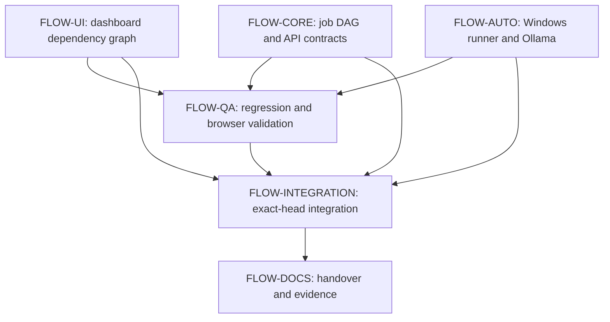

# NEXUS STUDIO PRO — Multi-flow execution plan

**Plan version:** v0.1  
**Date:** 2026-11-20  
**Repository:** https://github.com/justinhblee-prog/shorts  
**Coordination principle:** independent work proceeds on isolated branches; shared contracts and integration are serialized.  
**Truth rule:** a lane is `ACTIVE` only while a concrete tool/runner operation is executing. A defined lane is not evidence of a background agent.

## 1. Execution model

The work is divided into five delivery lanes plus one integration gate. Each lane owns a disjoint set of files and produces a reviewable change. The lanes can be developed independently; the integration gate combines them after focused validation.

| Lane | Ownership | Primary output | Current checkpoint | Next executable task |
|---|---|---|---|---|
| FLOW-UI | `frontend/**`, frontend tests in `backend/tests/test_frontend.py` | Real dashboard screens, responsive states, accessible interactions, browser evidence | Existing 19-module dashboard and development-job monitor passed hosted Chromium smoke in run 44592757768 | Show actual job dependency graph and group work by UI/Core/QA/Automation/Docs lane |
| FLOW-CORE | `backend/**`, database contracts and backend tests | Durable job graph, worker lease/fencing, APIs, security and provider adapters | Development job DAG, worker registry, event history and audited quarantine recovery exist | Verify persistence/recovery invariants and API contract gaps; keep shared schemas serialized |
| FLOW-AUTO | `.github/workflows/**`, runner scripts and runner contract tests | Safe Windows/Ollama execution, persistent tooling, exact Draft PR evidence | PR #409 moves backend/Aider venvs outside the clean worktree; hosted run 44592757768 passed | Windows runner preflight and two-run LocalAppData SQLite persistence proof |
| FLOW-QA | `backend/tests/**`, `scripts/**`, CI validation definitions | Regression coverage, Chromium smoke, exact-head evidence | Hosted suite and both dashboard/recovery browser smoke tests passed for PR #409 | Add UI dependency-graph assertions and preserve exact-head CI gates |
| FLOW-DOCS | `docs/**`, handover and operator guidance | Current decisions, status, validation boundaries, runbooks | PR #410 adds mainline-based handover and current workstream notes | Keep lane status and evidence synchronized with merged/verified heads |
| FLOW-INTEGRATION | Contract docs and coordinated integration only | Compatible integrated candidate, full test run, review-ready Draft PR | PR #407 integrated dashboard/recovery candidate; PR #409 worker fix is based on that candidate | Integrate UI/automation increments in dependency order; no automatic merge or deploy |

## 2. Dependency graph

UI, Core, Automation, and Docs can work on disjoint files concurrently. QA follows each lane's output and can run focused checks independently. Integration waits only for changes that share contracts or files; it does not block independent lane work.

## 3. File ownership and conflict rules

1. UI owns `frontend/**` and frontend-specific assertions only. It does not change backend routes, DB schemas, or worker behavior.
2. Core owns `backend/**` and backend API/schema contracts. It does not redesign dashboard layout.
3. Automation owns `.github/workflows/**` and runner contract tests. It does not change executor security policy without a Core review.
4. QA may add tests and smoke scripts in its owned test paths. If a test requires a product source change, the owning lane makes that change.
5. Docs owns `docs/**` and handover content. It records evidence but does not promote unverified behavior to complete.
6. One active writer per file. Shared API contracts, migrations, workflow permissions, and release gates require an integration decision before implementation.
7. Branches remain isolated Draft PRs. No automatic merge, deployment, secret rotation, public publishing, destructive migration, or paid-provider operation.

## 4. Completion contract

A lane item is complete only when all applicable conditions hold:

- A meaningful source or documentation diff exists; a no-op run is not completion.
- Focused tests pass and the exact tested commit SHA is recorded.
- UI work includes a browser-visible result and desktop/mobile checks.
- Backend work includes API/schema regression tests and security checks.
- Automation work includes workflow-contract tests; Windows/Ollama claims require the actual trusted Windows runner.
- QA evidence distinguishes hosted fixtures from real provider/runtime tests.
- Docs include changed decisions, exact PR/commit/run links, unresolved risks, and next dependency.
- The PR remains Draft until explicitly approved. CI passing never authorizes merge or production release.

## 5. Current queue and next order

| Order | Item | Lane | Status | Acceptance evidence |
|---:|---|---|---|---|
| 1 | Worker virtual environments outside clean checkout | FLOW-AUTO | Hosted PASS — PR #409 | Exact-head run 44592757768; Windows still unverified |
| 2 | Dashboard dependency graph and workstream grouping | FLOW-UI | Ready to implement | API-backed dependencies, lane grouping, no fabricated status, responsive browser smoke |
| 3 | Dependency/API contract regression for UI graph | FLOW-QA | Queued behind UI diff | Frontend assertions + analytics/recovery Chromium smoke |
| 4 | Windows runner and LocalAppData persistence | FLOW-AUTO | Blocked on trusted runner execution | Two separate workflow runs show same DB path and durable job/event state |
| 5 | Real local-model cycle | FLOW-CORE + FLOW-AUTO | Blocked on runner preflight | Ollama-generated scoped diff, passing validation, exact Draft PR artifact, dependency advancement |
| 6 | Integrated release-readiness review | FLOW-INTEGRATION + FLOW-DOCS | Waiting on 2–5 | Exact-head CI, reviewed diff, explicit live-test boundaries |

## 6. Current verified evidence

- PR #407 exact head `77333d264a123d80c87e6ca13f1edfc0282be06a`: 880 backend tests, repository validation, frontend syntax, analytics Chromium smoke and audited recovery Chromium smoke passed in run [44589059999](https://github.com/justinhblee-prog/shorts/actions/runs/44589059999). PR remains Draft/unmerged.
- PR #409 exact head `4d7286a7a4472736c0c037a34cff36743c54ae69`: workflow validation and both Chromium smoke suites passed in run [44592757768](https://github.com/justinhblee-prog/shorts/actions/runs/44592757768). Artifact [14564576167](https://github.com/justinhblee-prog/shorts/actions/runs/44592757768/artifacts/14564576167).
- PR #410 is the mainline-based handover documentation update: https://github.com/justinhblee-prog/shorts/pull/410.
- Hosted Linux CI does not verify the Windows self-hosted runner, persistent LocalAppData behavior, live Ollama generation, OAuth, real media rendering, or provider publishing.

## 7. Execution status protocol

Use only these states:

- `READY`: scoped and can be started.
- `ACTIVE`: an actual tool/runner operation is currently executing.
- `BLOCKED`: requires a named external capability or operator action.
- `VERIFYING`: code exists and exact validation is running.
- `PASS`: exact commit and validation evidence recorded.
- `NOT STARTED`: no implementation attempt yet.

Do not label several lanes as simultaneously ACTIVE unless separate operations are actually running. The chat does not continue background execution while idle; scheduled work requires an enabled workflow and an online trusted runner.

## 8. Live lane checkpoint — 2026-11-20

| Lane | State | Current evidence |
|---|---|---|
| FLOW-UI | VERIFYING | PR #412 adds source-backed workstream grouping and dependency labels; exact-head CI run [44594354319](https://github.com/justinhblee-prog/shorts/actions/runs/44594354319) is running |
| FLOW-QA | VERIFYING | PR #412 adds static presentation assertions and Chromium checks for UI/Core lanes plus a completed dependency edge; same exact-head run 44594354319 |
| FLOW-CORE | READY | Existing persisted DAG, dependency release, lease fencing and audit event APIs are in the integration candidate; next is review for missing invariants |
| FLOW-AUTO | PASS / BLOCKED | PR #409 hosted validation passed in run 44592757768; Windows self-hosted runner and LocalAppData two-run persistence remain BLOCKED pending actual trusted runner execution |
| FLOW-DOCS | ACTIVE | This execution plan and the handover/workstream docs are being maintained in PR #410/#411 |
| FLOW-INTEGRATION | READY | Wait for PR #412 exact-head CI, then review the UI/API contract and integration diff; no merge/deploy |

PR #412: https://github.com/justinhblee-prog/shorts/pull/412. Exact head at checkpoint: `150fdc86c9a2a7519ea406c7d4fb2d1bdb87f871`. These are lane states, not claims of separate autonomous agents running in the background.

## 9. Updated parallel validation checkpoint — 2026-11-20

- FLOW-UI / FLOW-QA: the initial implementation head `150fdc86c9a2a7519ea406c7d4fb2d1bdb87f871` passed full hosted validation and both Chromium smoke suites in run [44594354319](https://github.com/justinhblee-prog/shorts/actions/runs/44594354319), artifact [14564847559](https://github.com/justinhblee-prog/shorts/actions/runs/44594354319/artifacts/14564847559). A follow-up 320px mobile overflow assertion is now included in head `cf6b727252c8f33b3e90722d05cebef1bd40fe23`; runs [44594797445](https://github.com/justinhblee-prog/shorts/actions/runs/44594797445) and [44594782147](https://github.com/justinhblee-prog/shorts/actions/runs/44594782147) are in progress.
- FLOW-CORE: DAG mutation guard and three regression cases are in PR #413 at head `a80bff7f9dc3c4b7a5d5399008e76680802aebaf`; exact-head run [44594717811](https://github.com/justinhblee-prog/shorts/actions/runs/44594717811) is in progress.
- PR #412 UI implementation: https://github.com/justinhblee-prog/shorts/pull/412. PR #413 Core implementation: https://github.com/justinhblee-prog/shorts/pull/413.
- Only the runs listed as completed above are PASS. In-progress runs remain VERIFYING; Windows/Ollama remains BLOCKED pending the trusted runner.

## 10. UI lane exact-head PASS — 2026-11-20

- FLOW-UI and FLOW-QA are **PASS** at head `cf6b727252c8f33b3e90722d05cebef1bd40fe23`.
- Hosted run [44594782147](https://github.com/justinhblee-prog/shorts/actions/runs/44594782147) passed repository validation, frontend syntax, analytics Chromium smoke, recovery Chromium smoke, and artifact upload.
- The recovery browser flow confirmed UI/Core grouping, the persisted predecessor title and completed state, operator-confirmed quarantine recovery, and no horizontal overflow at 320px viewport width.
- Screenshot artifact: [14564938001](https://github.com/justinhblee-prog/shorts/actions/runs/44594782147/artifacts/14564938001).
- PR #412 remains Draft/unmerged: https://github.com/justinhblee-prog/shorts/pull/412.
- FLOW-CORE remains VERIFYING at head `5d3e7447d72788b8802dfe8c4bcdfd3de76b4ff8`; run [44595023343](https://github.com/justinhblee-prog/shorts/actions/runs/44595023343) is still running. Do not mark it PASS until completion.

## 11. Core lane validation checkpoint — 2026-11-20

- FLOW-CORE implementation PR #413 is at exact head `5d3e7447d72788b8802dfe8c4bcdfd3de76b4ff8`: https://github.com/justinhblee-prog/shorts/pull/413.
- `scripts/validate.sh` and frontend syntax passed at this exact head in hosted run [44595023343](https://github.com/justinhblee-prog/shorts/actions/runs/44595023343).
- Chromium setup/browser smoke and artifact upload are still in progress. FLOW-CORE remains VERIFYING until the entire run succeeds.

## 12. Core lane exact-head PASS — 2026-11-20

- FLOW-CORE is **PASS** at head `5d3e7447d72788b8802dfe8c4bcdfd3de76b4ff8`.
- Hosted run [44595023343](https://github.com/justinhblee-prog/shorts/actions/runs/44595023343) succeeded: repository validation (including new DAG mutation regressions), frontend syntax, analytics Chromium smoke, recovery Chromium smoke, and artifact upload [14565337019](https://github.com/justinhblee-prog/shorts/actions/runs/44595023343/artifacts/14565337019).
- PR #413 remains Draft/unmerged: https://github.com/justinhblee-prog/shorts/pull/413.
- FLOW-UI and FLOW-QA remain PASS at the tested 320px-capable head in section 10. FLOW-AUTO hosted checks passed under PR #409; real Windows/Ollama execution remains BLOCKED.

## 13. Automation integrity QA lane — 2026-11-20

- FLOW-AUTO / FLOW-QA opened PR #414: https://github.com/justinhblee-prog/shorts/pull/414.
- Added runtime path-containment guards for both persistent Windows tool virtual environments: even a misconfigured `LOCALAPPDATA` cannot place tooling inside `GITHUB_WORKSPACE` and break the clean-worktree invariant.
- Added an explicit check that the persisted Aider environment still contains `Scripts/python.exe` before accepting its launcher.
- Regression tests cover both containment guards and the Aider interpreter check.
- Exact-head CI for `8bb993a084b1f6b78730e78a49e943166f4f5e17` is running as of this checkpoint (workflow runs [44595671151](https://github.com/justinhblee-prog/shorts/actions/runs/44595671151) and [44595698428](https://github.com/justinhblee-prog/shorts/actions/runs/44595698428)). FLOW-AUTO remains VERIFYING until exact-head validation completes.
- This is hosted validation only; trusted Windows self-hosted execution and two-run LocalAppData persistence remain unverified.

## 14. Automation integrity exact-head PASS — 2026-11-20

- FLOW-AUTO / FLOW-QA hosted validation is **PASS** at exact head `8bb993a084b1f6b78730e78a49e943166f4f5e17` in both independent workflow runs [44595671151](https://github.com/justinhblee-prog/shorts/actions/runs/44595671151) and [44595698428](https://github.com/justinhblee-prog/shorts/actions/runs/44595698428). Each run completed all 17 steps successfully.
- Browser evidence artifacts: [14566421219](https://github.com/justinhblee-prog/shorts/actions/runs/44595671151/artifacts/14566421219) and [14564399810](https://github.com/justinhblee-prog/shorts/actions/runs/44595698428/artifacts/14564399810).
- The tested workflow now keeps both persistent virtual environments outside the checkout, rejects a misconfigured tool root inside `GITHUB_WORKSPACE`, refuses destructive repair of incomplete existing environments, and verifies the Aider Python interpreter before trusting its launcher.
- PR #414 remains Draft/unmerged: https://github.com/justinhblee-prog/shorts/pull/414.
- **Validation boundary:** these hosted runs exercise workflow contracts and hosted Chromium fixtures. They do not prove actual Windows self-hosted runner execution, persistence across two real runner jobs, or a live Ollama generation cycle. Those remain BLOCKED pending trusted runner evidence.

## 15. Current lane state after PR #414 validation — 2026-11-20

| Lane | State | Evidence / remaining gate |
|---|---|---|
| FLOW-UI | PASS | PR #412 exact tested head `cf6b727252c8f33b3e90722d05cebef1bd40fe23`, hosted run 44594782147 |
| FLOW-CORE | PASS | PR #413 exact tested head `5d3e7447d72788b8802dfe8c4bcdfd3de76b4ff8`, hosted run 44595023343 |
| FLOW-AUTO | PASS / BLOCKED | PR #414 exact tested head `8bb993a084b1f6b78730e78a49e943166f4f5e17`, hosted runs 44595671151 and 44595698428; trusted Windows/Ollama runtime remains unverified |
| FLOW-QA | PASS | Exact-head hosted validation and Chromium smoke evidence recorded for PRs #412–#414 |
| FLOW-DOCS | ACTIVE | This handover updated with exact-head evidence and remaining external gates |
| FLOW-INTEGRATION | READY | Review cross-PR base compatibility and aggregate changes; keep all PRs Draft and do not merge/deploy |

## 16. Integration ancestry and file-ownership review — 2026-11-20

- PRs #412 (UI), #413 (Core), and #409 (Automation baseline) all target `integration/nexus-ui-current-verified` at base `77333d264a123d80c87e6ca13f1edfc0282be06a`; each is currently open, Draft, and reported mergeable.
- PR #412 owns frontend files and its browser-smoke fixtures; PR #413 owns `backend/development_jobs.py` and its focused tests. Their changed-file sets are disjoint, and both are based directly on the same integration candidate.
- PR #414 is not an independent sibling of #409: commit comparison confirms #414 head `8bb993a084b1f6b78730e78a49e943166f4f5e17` is exactly two commits ahead of, and contains, #409 head `4d7286a7a4472736c0c037a34cff36743c54ae69`. They both modify the same workflow and workflow-contract test. Preserve the ancestry/order **#409 before #414** during integration; do not treat their same-base PR metadata as proof of independent changes.
- PR #411 is likewise stacked on PR #410: its base SHA is exactly #410 head `56bb66ca18000563f95f999bc9a94e3f35ed0bf3`. Preserve **#410 before #411** when integrating documentation.
- Recommended integration sequence after explicit approval: integrate the shared baseline candidate first; then the independent UI/Core changes (#412/#413); then Automation baseline #409 followed by its integrity hardening #414; then the documentation stack #410 followed by #411. Re-run full validation on the resulting combined head because individual branch PASS evidence does not certify the aggregate merge result.
- No merge or deployment was performed. All six PRs remain Draft pending user approval and the external Windows/Ollama gate.
