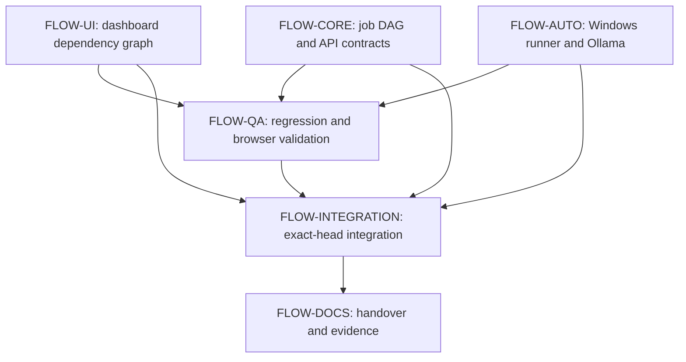

# NEXUS STUDIO PRO — Multi-flow execution plan

**Plan version:** v0.1  
**Date:** 2026-11-20  
**Repository:** https://github.com/justinhblee-prog/shorts  
**Coordination principle:** independent work proceeds on isolated branches; shared contracts and integration are serialized.  
**Truth rule:** a lane is `ACTIVE` only while a concrete tool/runner operation is executing. A defined lane is not evidence of a background agent.

## 1. Execution model

The work is divided into five delivery lanes plus one integration gate. Each lane owns a disjoint set of files and produces a reviewable change. The lanes can be developed independently; the integration gate combines them after focused validation.

| Lane | Ownership | Primary output | Current checkpoint | Next executable task |
|---|---|---|---|---|
| FLOW-UI | `frontend/**`, frontend tests in `backend/tests/test_frontend.py` | Real dashboard screens, responsive states, accessible interactions, browser evidence | Development-job board renders persisted dependencies and groups jobs by scope; full seven-lane responsive classification regression added on 2026-11-20 | Extend API-backed DAG/edge visibility and maintain desktop/mobile browser evidence |
| FLOW-CORE | `backend/**`, database contracts and backend tests | Durable job graph, worker lease/fencing, APIs, security and provider adapters | Development job DAG, worker registry, event history and audited quarantine recovery exist | Verify persistence/recovery invariants and API contract gaps; keep shared schemas serialized |
| FLOW-AUTO | `.github/workflows/**`, runner scripts and runner contract tests | Safe Windows/Ollama execution, persistent tooling, exact Draft PR evidence | PR #409 moves backend/Aider venvs outside the clean worktree; hosted run 44592757768 passed | Windows runner preflight and two-run LocalAppData SQLite persistence proof |
| FLOW-QA | `backend/tests/**`, `scripts/**`, CI validation definitions | Regression coverage, Chromium smoke, exact-head evidence | Hosted suite and both dashboard/recovery browser smoke tests passed for PR #409 | Seven-lane classification and 320px visibility assertions added; verify exact-head CI and add explicit cross-lane/missing-prerequisite edge cases |
| FLOW-DOCS | `docs/**`, handover and operator guidance | Current decisions, status, validation boundaries, runbooks | PR #410 adds mainline-based handover and current workstream notes | Keep lane status and evidence synchronized with merged/verified heads |
| FLOW-INTEGRATION | Contract docs and coordinated integration only | Compatible integrated candidate, full test run, review-ready Draft PR | PR #407 integrated dashboard/recovery candidate; PR #409 worker fix is based on that candidate | Integrate UI/automation increments in dependency order; no automatic merge or deploy |

## 2. Dependency graph

UI, Core, Automation, and Docs can work on disjoint files concurrently. QA follows each lane's output and can run focused checks independently. Integration waits only for changes that share contracts or files; it does not block independent lane work.

## 3. File ownership and conflict rules

1. UI owns `frontend/**` and frontend-specific assertions only. It does not change backend routes, DB schemas, or worker behavior.
2. Core owns `backend/**` and backend API/schema contracts. It does not redesign dashboard layout.
3. Automation owns `.github/workflows/**` and runner contract tests. It does not change executor security policy without a Core review.
4. QA may add tests and smoke scripts in its owned test paths. If a test requires a product source change, the owning lane makes that change.
5. Docs owns `docs/**` and handover content. It records evidence but does not promote unverified behavior to complete.
6. One active writer per file. Shared API contracts, migrations, workflow permissions, and release gates require an integration decision before implementation.
7. Branches remain isolated Draft PRs. No automatic merge, deployment, secret rotation, public publishing, destructive migration, or paid-provider operation.

## 4. Completion contract

A lane item is complete only when all applicable conditions hold:

- A meaningful source or documentation diff exists; a no-op run is not completion.
- Focused tests pass and the exact tested commit SHA is recorded.
- UI work includes a browser-visible result and desktop/mobile checks.
- Backend work includes API/schema regression tests and security checks.
- Automation work includes workflow-contract tests; Windows/Ollama claims require the actual trusted Windows runner.
- QA evidence distinguishes hosted fixtures from real provider/runtime tests.
- Docs include changed decisions, exact PR/commit/run links, unresolved risks, and next dependency.
- The PR remains Draft until explicitly approved. CI passing never authorizes merge or production release.

## 5. Current queue and next order

| Order | Item | Lane | Status | Acceptance evidence |
|---:|---|---|---|---|
| 1 | Worker virtual environments outside clean checkout | FLOW-AUTO | Hosted PASS — PR #409 | Exact-head run 44592757768; Windows still unverified |
| 2 | Dashboard dependency graph and workstream grouping | FLOW-UI | Implemented; expanded QA in CI | Persisted API dependencies, scope-derived seven-lane grouping, no fabricated status, responsive browser smoke |
| 3 | Dependency/API contract regression for UI graph | FLOW-QA | Expanded; exact-head CI pending | Seven lane classes and 320px visibility asserted by recovery Chromium smoke |
| 4 | Windows runner and LocalAppData persistence | FLOW-AUTO | Blocked on trusted runner execution | Two separate workflow runs show same DB path and durable job/event state |
| 5 | Real local-model cycle | FLOW-CORE + FLOW-AUTO | Blocked on runner preflight | Ollama-generated scoped diff, passing validation, exact Draft PR artifact, dependency advancement |
| 6 | Integrated release-readiness review | FLOW-INTEGRATION + FLOW-DOCS | Waiting on 2–5 | Exact-head CI, reviewed diff, explicit live-test boundaries |

## 6. Current verified evidence

- PR #407 exact head `77333d264a123d80c87e6ca13f1edfc0282be06a`: 880 backend tests, repository validation, frontend syntax, analytics Chromium smoke and audited recovery Chromium smoke passed in run [44589059999](https://github.com/justinhblee-prog/shorts/actions/runs/44589059999). PR remains Draft/unmerged.
- PR #409 exact head `4d7286a7a4472736c0c037a34cff36743c54ae69`: workflow validation and both Chromium smoke suites passed in run [44592757768](https://github.com/justinhblee-prog/shorts/actions/runs/44592757768). Artifact [14564576167](https://github.com/justinhblee-prog/shorts/actions/runs/44592757768/artifacts/14564576167).
- PR #410 is the mainline-based handover documentation update: https://github.com/justinhblee-prog/shorts/pull/410.
- Hosted Linux CI does not verify the Windows self-hosted runner, persistent LocalAppData behavior, live Ollama generation, OAuth, real media rendering, or provider publishing.

## 7. Execution status protocol

Use only these states:

- `READY`: scoped and can be started.
- `ACTIVE`: an actual tool/runner operation is currently executing.
- `BLOCKED`: requires a named external capability or operator action.
- `VERIFYING`: code exists and exact validation is running.
- `PASS`: exact commit and validation evidence recorded.
- `NOT STARTED`: no implementation attempt yet.

Do not label several lanes as simultaneously ACTIVE unless separate operations are actually running. The chat does not continue background execution while idle; scheduled work requires an enabled workflow and an online trusted runner.

## 8. Live lane checkpoint — 2026-11-20

| Lane | State | Current evidence |
|---|---|---|
| FLOW-UI | VERIFYING | PR #412 adds source-backed workstream grouping and dependency labels; exact-head CI run [44594354319](https://github.com/justinhblee-prog/shorts/actions/runs/44594354319) is running |
| FLOW-QA | VERIFYING | PR #412 adds static presentation assertions and Chromium checks for UI/Core lanes plus a completed dependency edge; same exact-head run 44594354319 |
| FLOW-CORE | READY | Existing persisted DAG, dependency release, lease fencing and audit event APIs are in the integration candidate; next is review for missing invariants |
| FLOW-AUTO | PASS / BLOCKED | PR #409 hosted validation passed in run 44592757768; Windows self-hosted runner and LocalAppData two-run persistence remain BLOCKED pending actual trusted runner execution |
| FLOW-DOCS | ACTIVE | This execution plan and the handover/workstream docs are being maintained in PR #410/#411 |
| FLOW-INTEGRATION | READY | Wait for PR #412 exact-head CI, then review the UI/API contract and integration diff; no merge/deploy |

PR #412: https://github.com/justinhblee-prog/shorts/pull/412. Exact head at checkpoint: `150fdc86c9a2a7519ea406c7d4fb2d1bdb87f871`. These are lane states, not claims of separate autonomous agents running in the background.

## 9. Updated parallel validation checkpoint — 2026-11-20

- FLOW-UI / FLOW-QA: the initial implementation head `150fdc86c9a2a7519ea406c7d4fb2d1bdb87f871` passed full hosted validation and both Chromium smoke suites in run [44594354319](https://github.com/justinhblee-prog/shorts/actions/runs/44594354319), artifact [14564847559](https://github.com/justinhblee-prog/shorts/actions/runs/44594354319/artifacts/14564847559). A follow-up 320px mobile overflow assertion is now included in head `cf6b727252c8f33b3e90722d05cebef1bd40fe23`; runs [44594797445](https://github.com/justinhblee-prog/shorts/actions/runs/44594797445) and [44594782147](https://github.com/justinhblee-prog/shorts/actions/runs/44594782147) are in progress.
- FLOW-CORE: DAG mutation guard and three regression cases are in PR #413 at head `a80bff7f9dc3c4b7a5d5399008e76680802aebaf`; exact-head run [44594717811](https://github.com/justinhblee-prog/shorts/actions/runs/44594717811) is in progress.
- PR #412 UI implementation: https://github.com/justinhblee-prog/shorts/pull/412. PR #413 Core implementation: https://github.com/justinhblee-prog/shorts/pull/413.
- Only the runs listed as completed above are PASS. In-progress runs remain VERIFYING; Windows/Ollama remains BLOCKED pending the trusted runner.

## 10. UI lane exact-head PASS — 2026-11-20

- FLOW-UI and FLOW-QA are **PASS** at head `cf6b727252c8f33b3e90722d05cebef1bd40fe23`.
- Hosted run [44594782147](https://github.com/justinhblee-prog/shorts/actions/runs/44594782147) passed repository validation, frontend syntax, analytics Chromium smoke, recovery Chromium smoke, and artifact upload.
- The recovery browser flow confirmed UI/Core grouping, the persisted predecessor title and completed state, operator-confirmed quarantine recovery, and no horizontal overflow at 320px viewport width.
- Screenshot artifact: [14564938001](https://github.com/justinhblee-prog/shorts/actions/runs/44594782147/artifacts/14564938001).
- PR #412 remains Draft/unmerged: https://github.com/justinhblee-prog/shorts/pull/412.
- FLOW-CORE remains VERIFYING at head `5d3e7447d72788b8802dfe8c4bcdfd3de76b4ff8`; run [44595023343](https://github.com/justinhblee-prog/shorts/actions/runs/44595023343) is still running. Do not mark it PASS until completion.

## 11. Core lane validation checkpoint — 2026-11-20

- FLOW-CORE implementation PR #413 is at exact head `5d3e7447d72788b8802dfe8c4bcdfd3de76b4ff8`: https://github.com/justinhblee-prog/shorts/pull/413.
- `scripts/validate.sh` and frontend syntax passed at this exact head in hosted run [44595023343](https://github.com/justinhblee-prog/shorts/actions/runs/44595023343).
- Chromium setup/browser smoke and artifact upload are still in progress. FLOW-CORE remains VERIFYING until the entire run succeeds.

## 12. Core lane exact-head PASS — 2026-11-20

- FLOW-CORE is **PASS** at head `5d3e7447d72788b8802dfe8c4bcdfd3de76b4ff8`.
- Hosted run [44595023343](https://github.com/justinhblee-prog/shorts/actions/runs/44595023343) succeeded: repository validation (including new DAG mutation regressions), frontend syntax, analytics Chromium smoke, recovery Chromium smoke, and artifact upload [14565337019](https://github.com/justinhblee-prog/shorts/actions/runs/44595023343/artifacts/14565337019).
- PR #413 remains Draft/unmerged: https://github.com/justinhblee-prog/shorts/pull/413.
- FLOW-UI and FLOW-QA remain PASS at the tested 320px-capable head in section 10. FLOW-AUTO hosted checks passed under PR #409; real Windows/Ollama execution remains BLOCKED.

## 13. Automation integrity QA lane — 2026-11-20

- FLOW-AUTO / FLOW-QA opened PR #414: https://github.com/justinhblee-prog/shorts/pull/414.
- Added runtime path-containment guards for both persistent Windows tool virtual environments: even a misconfigured `LOCALAPPDATA` cannot place tooling inside `GITHUB_WORKSPACE` and break the clean-worktree invariant.
- Added an explicit check that the persisted Aider environment still contains `Scripts/python.exe` before accepting its launcher.
- Regression tests cover both containment guards and the Aider interpreter check.
- Exact-head CI for `8bb993a084b1f6b78730e78a49e943166f4f5e17` is running as of this checkpoint (workflow runs [44595671151](https://github.com/justinhblee-prog/shorts/actions/runs/44595671151) and [44595698428](https://github.com/justinhblee-prog/shorts/actions/runs/44595698428)). FLOW-AUTO remains VERIFYING until exact-head validation completes.
- This is hosted validation only; trusted Windows self-hosted execution and two-run LocalAppData persistence remain unverified.

## 14. Automation integrity exact-head PASS — 2026-11-20

- FLOW-AUTO / FLOW-QA hosted validation is **PASS** at exact head `8bb993a084b1f6b78730e78a49e943166f4f5e17` in both independent workflow runs [44595671151](https://github.com/justinhblee-prog/shorts/actions/runs/44595671151) and [44595698428](https://github.com/justinhblee-prog/shorts/actions/runs/44595698428). Each run completed all 17 steps successfully.
- Browser evidence artifacts: [14566421219](https://github.com/justinhblee-prog/shorts/actions/runs/44595671151/artifacts/14566421219) and [14564399810](https://github.com/justinhblee-prog/shorts/actions/runs/44595698428/artifacts/14564399810).
- The tested workflow now keeps both persistent virtual environments outside the checkout, rejects a misconfigured tool root inside `GITHUB_WORKSPACE`, refuses destructive repair of incomplete existing environments, and verifies the Aider Python interpreter before trusting its launcher.
- PR #414 remains Draft/unmerged: https://github.com/justinhblee-prog/shorts/pull/414.
- **Validation boundary:** these hosted runs exercise workflow contracts and hosted Chromium fixtures. They do not prove actual Windows self-hosted runner execution, persistence across two real runner jobs, or a live Ollama generation cycle. Those remain BLOCKED pending trusted runner evidence.

## 15. Current lane state after PR #414 validation — 2026-11-20

| Lane | State | Evidence / remaining gate |
|---|---|---|
| FLOW-UI | PASS | PR #412 exact tested head `cf6b727252c8f33b3e90722d05cebef1bd40fe23`, hosted run 44594782147 |
| FLOW-CORE | PASS | PR #413 exact tested head `5d3e7447d72788b8802dfe8c4bcdfd3de76b4ff8`, hosted run 44595023343 |
| FLOW-AUTO | PASS / BLOCKED | PR #414 exact tested head `8bb993a084b1f6b78730e78a49e943166f4f5e17`, hosted runs 44595671151 and 44595698428; trusted Windows/Ollama runtime remains unverified |
| FLOW-QA | PASS | Exact-head hosted validation and Chromium smoke evidence recorded for PRs #412–#414 |
| FLOW-DOCS | ACTIVE | This handover updated with exact-head evidence and remaining external gates |
| FLOW-INTEGRATION | READY | Review cross-PR base compatibility and aggregate changes; keep all PRs Draft and do not merge/deploy |

## 16. Integration ancestry and file-ownership review — 2026-11-20

- PRs #412 (UI), #413 (Core), and #409 (Automation baseline) all target `integration/nexus-ui-current-verified` at base `77333d264a123d80c87e6ca13f1edfc0282be06a`; each is currently open, Draft, and reported mergeable.
- PR #412 owns frontend files and its browser-smoke fixtures; PR #413 owns `backend/development_jobs.py` and its focused tests. Their changed-file sets are disjoint, and both are based directly on the same integration candidate.
- PR #414 is not an independent sibling of #409: commit comparison confirms #414 head `8bb993a084b1f6b78730e78a49e943166f4f5e17` is exactly two commits ahead of, and contains, #409 head `4d7286a7a4472736c0c037a34cff36743c54ae69`. They both modify the same workflow and workflow-contract test. Preserve the ancestry/order **#409 before #414** during integration; do not treat their same-base PR metadata as proof of independent changes.
- PR #411 is likewise stacked on PR #410: its base SHA is exactly #410 head `56bb66ca18000563f95f999bc9a94e3f35ed0bf3`. Preserve **#410 before #411** when integrating documentation.
- Recommended integration sequence after explicit approval: integrate the shared baseline candidate first; then the independent UI/Core changes (#412/#413); then Automation baseline #409 followed by its integrity hardening #414; then the documentation stack #410 followed by #411. Re-run full validation on the resulting combined head because individual branch PASS evidence does not certify the aggregate merge result.
- No merge or deployment was performed. All six PRs remain Draft pending user approval and the external Windows/Ollama gate.

## 17. Parent integration stack review — 2026-11-20

- PR #407 is the parent integration candidate: it targets `integration/core-policy-ui-candidate-2026-11-20` (base `04e52a4c6c06687b11ea17c7c45a2f9b561eeee0`) and its head is `4541b91ce7d440aafcf3732dc8487679793cac56`.
- `integration/nexus-ui-current-verified` is 36 commits ahead of that same base at `77333d264a123d80c87e6ca13f1edfc0282be06a`. PR #407's head is a further 26 commits ahead of the current verified branch, with the current branch as its merge base. Thus #407 is a superset candidate, not an unrelated branch.
- The additional 26 commits in #407 touch files also changed by child PR #412, including `frontend/app.js`, `frontend/index.html`, `backend/tests/test_frontend.py`, and related UI/API files. The child PRs' isolated PASS evidence therefore does not remove the need to reconcile their changes with the parent integration delta.
- FLOW-INTEGRATION is now **BLOCKED / review required**: do not merge #407 or child PRs in an arbitrary order. First reconcile the parent/child branch stack and overlapping UI changes, then run full validation on one aggregate exact head. Automation ancestry still requires #409 before #414; docs ancestry still requires #410 before #411.
- The integration branch is also 5 commits behind `main` and 1,243 commits ahead according to GitHub comparison. This is recorded as a branch-divergence fact, not a recommendation to merge into main. Mainline promotion remains out of scope and requires a separate review.
- No branches were force-pushed, rebased, merged, or deployed during this review.

## 18. Aggregate UI + Core integration candidate created — 2026-11-20

- Created Draft PR #415: https://github.com/justinhblee-prog/shorts/pull/415.
- Aggregate branch: `integration/nexus-aggregate-ui-core-2026-11-20`; base: `integration/core-policy-ui-candidate-2026-11-20`; exact head at creation: `ae7ed6574a4a3eaac306215d9702e2f33c4f0fd4`.
- This candidate starts from PR #407's integration head and transplants the independent UI lane/dependency presentation from #412 and Core DAG mutation guards from #413. It therefore resolves the earlier parent/child ordering ambiguity by carrying one combined change set rather than asking reviewers to merge overlapping PRs independently.
- Combined change surface: 22 files, 2,523 additions, 188 deletions at PR creation. It includes the parent dashboard/API hardening, UI workstream board and responsive dependency display, Core DAG state guards, focused unit tests, and a browser fixture that exercises a completed UI prerequisite plus a dependent quarantined Core job.
- PR #415 reports mergeable=true after creation. No workflow run was visible for its exact head at the first check; aggregate validation remains **PENDING**, and no individual PR PASS is being reused as aggregate PASS.
- PRs #407, #412, and #413 remain Draft/unmerged; #415 is the combined review candidate. Keep them all unmerged until #415 exact-head CI passes and the aggregate diff is reviewed.
- Automation (#409 -> #414) and documentation (#410 -> #411) are still separate stacks and have not yet been transplanted into #415. Do not mark integration complete.
- No merge, deployment, rebase, or force-push was performed.

### PR #415 exact-head CI tracking update

- Exact head `ae7ed6574a4a3eaac306215d9702e2f33c4f0fd4` is now attached to two GitHub Actions test runs: [44597011173](https://github.com/justinhblee-prog/shorts/actions/runs/44597011173) and [44596966746](https://github.com/justinhblee-prog/shorts/actions/runs/44596966746).
- At the latest check both jobs were still `in_progress` (one in dependency installation, one in repository validation); neither had reported a failure. This is **VERIFYING**, not PASS.
- PR #415 remains Draft and GitHub currently reports it mergeable. No merge or deployment.

## 19. Automation integrity transplanted into aggregate candidate — 2026-11-20

- Transplanted the final Automation integrity state from PR #414 (which includes the #409 baseline) into aggregate branch `integration/nexus-aggregate-ui-core-2026-11-20`.
- Updated `.github/workflows/nexus-development-job-worker.yml` and `backend/tests/test_development_worker_workflow_contract.py` to keep backend/Aider virtual environments under persistent LocalAppData, reject tool roots inside the checkout, refuse destructive repair of incomplete environments, and verify the Aider Python interpreter before launcher use.
- Aggregate head after the two file updates: `75ef3329f8f2e85b2cf09879902ed285e8d64de1`. PR #415 now contains 72 commits and 24 changed files (2,593 additions / 205 deletions).
- Exact-head hosted CI was automatically triggered for this new SHA: run [44600985186](https://github.com/justinhblee-prog/shorts/actions/runs/44600985186) and run [44600976216](https://github.com/justinhblee-prog/shorts/actions/runs/44600976216). Both were **in progress** at the time of this update; aggregate Automation integration remains VERIFYING until both complete successfully.
- The prior aggregate UI+Core head `ae7ed6574a4a3eaac306215d9702e2f33c4f0fd4` passed both hosted checks (runs [44597011173](https://github.com/justinhblee-prog/shorts/actions/runs/44597011173) and [44596966746](https://github.com/justinhblee-prog/shorts/actions/runs/44596966746)); each completed all 17 steps. Artifacts: [14565152825](https://github.com/justinhblee-prog/shorts/actions/runs/44597011173/artifacts/14565152825) and [14566382219](https://github.com/justinhblee-prog/shorts/actions/runs/44596966746/artifacts/14566382219). This prior PASS does not certify the new SHA.
- Trusted Windows self-hosted execution, two-run LocalAppData persistence, and live Ollama generation remain BLOCKED / unverified. PR #415 remains Draft; no merge or deployment.

## 20. Handover documentation integrated into aggregate candidate — 2026-11-20

- Added the mainline-based handover from PR #410 and the multi-flow plan/workstream updates from PR #411 into the aggregate candidate. Files: `docs/INTEGRATION_HANDOVER_2026-11-20.md`, `docs/MULTI_FLOW_EXECUTION.md`, and `docs/WORKSTREAMS.md`.
- Aggregate branch now carries UI, Core, Automation integrity, and documentation lanes in one review candidate. PR #415 remains Draft; the documentation stack PRs #410/#411 remain open and unmerged as source records.
- Exact current branch head must be taken from PR #415; hosted checks are re-triggered by the documentation commits and must pass on that final SHA before the aggregate can be marked PASS.
- External gate remains unchanged: trusted Windows self-hosted runner, two-run persistent LocalAppData proof, and live Ollama generation are not verified by hosted Linux checks.

### Latest exact-head CI checkpoint — 2026-11-20

- Final documented aggregate head: `2493d08fa13bb02326f1220bc43929f56ba9414f`.
- Two exact-head hosted validation runs are active: [44601181264](https://github.com/justinhblee-prog/shorts/actions/runs/44601181264) and [44601169889](https://github.com/justinhblee-prog/shorts/actions/runs/44601169889). Both have passed initial setup/dependency steps and are executing `scripts/validate.sh`; no failures have been reported.
- Earlier Automation-head run [44600976216](https://github.com/justinhblee-prog/shorts/actions/runs/44600976216) completed successfully (17 steps). The companion browser run [44600985186](https://github.com/justinhblee-prog/shorts/actions/runs/44600985186) is still progressing through Chromium/browser smoke. These runs target the earlier Automation-only SHA and are not substitutes for final aggregate validation.
- Current aggregate state: **VERIFYING**. Do not mark PASS until both checks for `2493d08...` complete successfully.

## 21. Aggregate exact-head hosted validation PASS — 2026-11-20

- Aggregate candidate PR #415 is at head `cb67ee8505ca508dddbb753761d4954a8a345fc9` (77 commits, 27 changed files). Both exact-head hosted runs completed successfully: [44601341416](https://github.com/justinhblee-prog/shorts/actions/runs/44601341416) and [44601350386](https://github.com/justinhblee-prog/shorts/actions/runs/44601350386), each with all 17 steps successful.
- The successful steps include `scripts/validate.sh`, frontend JavaScript syntax validation, analytics Chromium smoke, dependency/recovery Chromium smoke, and browser artifact upload.
- Browser artifact archive: [14566419852](https://github.com/justinhblee-prog/shorts/actions/runs/44601341416/artifacts/14566419852). Desktop and 320px mobile screenshots were retrieved from this exact run and visually inspected.
- FLOW-UI, FLOW-CORE, FLOW-AUTO workflow-contract coverage, and FLOW-QA are **PASS for hosted validation at this aggregate head**. This does not promote the independent Windows/Ollama runtime gate to PASS.
- FLOW-AUTO live-runtime gate remains **BLOCKED** pending a trusted Windows runner: actual runner preflight, two separate-run LocalAppData SQLite persistence evidence, and one live Ollama-generated scoped change with verified Draft PR artifact.
- PR #415 description was synchronized with the exact-head evidence. PR #415 remains Draft/open/unmerged; no deployment, merge, or public publishing occurred.

## Windows runner activation gate — 2026-11-20

- The worker definition `.github/workflows/nexus-development-job-worker.yml` currently exists on the integration candidate branch. GitHub requires a `workflow_dispatch` workflow to exist on the repository default branch before it can be manually dispatched; scheduled runs are also evaluated from the default branch.
- Therefore the Windows/Ollama lane is **implemented but not yet triggerable from this unmerged candidate**. This is a repository activation dependency, not evidence that the self-hosted runner is offline or that a Windows execution failed.
- The available GitHub connection exposes workflow-run inspection and rerun operations but no workflow-dispatch action. No dispatch was attempted or claimed.
- Activation requires an authorized change that makes this workflow available on the default branch, followed by an actual Windows run and a second run proving LocalAppData tooling/database persistence. Keep this gate open; do not mark Windows/Ollama validation PASS based on Linux CI.

## 23. Default-branch activation dependency audit — 2026-11-20

- Rechecked repository default branch metadata: `main`.
- Confirmed `.github/workflows/nexus-development-job-worker.yml` is absent from `main` (GitHub Contents API returned 404 for that path).
- Confirmed the worker's executable prerequisites are also absent from `main`: `backend/run_development_agent.py`, `backend/development_agent_executor.py`, `backend/recover_development_reviews.py`, `backend/publish_development_reviews.py`, and `backend/tests/test_development_worker_workflow_contract.py`.
- `backend/requirements.txt` exists on `main`, but that alone is insufficient: the workflow's Python entrypoints and contract tests are not present there. Copying only the workflow file to `main` would create a broken activation and is explicitly not the next step.
- Required promotion unit must be dependency-complete and reviewed as one stack: worker workflow + worker/executor/backlog/intake/review-publication modules + seed/data contracts + tests + any required backend dependencies. Before proposing activation, compare every imported module and referenced path against `main`, then run the main-targeted CI suite on the promotion branch.
- No promotion PR, default-branch update, workflow dispatch, merge, or runner execution was performed. This is a verified activation dependency, not a claim that the Windows runner is offline.

## 24. Worker activation dependency closure — 2026-11-20

A second-pass import and call-site audit expands the promotion boundary beyond the initial missing-file checks.

### Runtime import closure (all confirmed absent from `main`)
- `backend/run_development_agent.py` — scheduled/manual entrypoint.
- `backend/development_agent_executor.py` — constrained Aider subprocess executor; imports `development_job_worker` and `development_security`.
- `backend/development_backlog_service.py` — coordinator; imports `development_job_worker` and `development_github_intake`.
- `backend/development_github_intake.py` — read-only issue intake; imports `development_jobs`.
- `backend/development_job_worker.py` — lease/heartbeat worker; imports `development_jobs` and `development_security`.
- `backend/development_jobs.py` — SQLite DAG/lease/evidence store; imports `development_security`.
- `backend/development_security.py` — diagnostic redaction.
- `backend/seed_development_jobs.py` — idempotent seed graph; imports `development_jobs`.
- `backend/recover_development_reviews.py` — read-only review recovery; imports `development_jobs` and `publish_development_reviews`.
- `backend/publish_development_reviews.py` — exact Draft PR artifact verification/publication; imports `development_jobs`.
- `.github/workflows/nexus-development-job-worker.yml` — invokes the entrypoints and contains the Windows runner/toolchain contract.

### Validation and documentation closure
- `backend/tests/test_development_worker_workflow_contract.py` is confirmed absent from `main`.
- Promotion must also include worker-specific unit/regression tests, orchestration design contract, and any workflow path filters/validation scripts required by those tests. Final filenames must be enumerated from the branch tree/CI discovery; do not infer them from guessed names.
- `backend/requirements.txt` already exists on `main`. Recheck the complete import graph and dependency diff at promotion time rather than replacing unrelated backend dependencies.

### Activation configuration and security gates
- Workflow job permissions include contents write, pull-request write, and actions write. Keep the read-only intake/recovery token separate from the built-in token used for Draft PR operations; verify exact scopes and repository Actions permissions before activation.
- Required runtime: trusted self-hosted Windows runner labelled `self-hosted, windows, nexus-local-ai`, runner version >= 2.327.1, Python >= 3.11, Git Bash/POSIX shell, Node >= 18, loopback Ollama API, and exact `qwen2.5-coder:7b` model availability.
- Required configuration includes `NEXUS_GITHUB_READ_TOKEN` (fine-grained read-only intake/recovery), `NEXUS_APPROVED_SCOPES` (explicit path allowlist; empty object is fail-closed), and repository GITHUB_TOKEN permissions for Draft PR operations and bounded workflow continuation.
- SQLite state and backend/Aider virtual environments are outside `GITHUB_WORKSPACE` under LocalAppData. A real second-run check is still required to prove persistence; hosted Linux CI cannot prove Windows path semantics or local Ollama operation.
- The executor strips GitHub/provider credentials from the child process environment and validates repository-relative scopes, including resolved symlink targets. These code-level controls do not replace trusted-runner isolation and review of allowed Aider behavior.
- The workflow sends issue descriptions to a local coding agent on a self-hosted runner. Before scheduled execution, confirm the runner is dedicated/isolated, contains no unrelated credentials or sensitive workspaces, and approved scopes exclude secrets, production data, and runner configuration. Do not use a general-purpose workstation runner.

### Promotion rule
Do not create a workflow-only activation change. Prepare a dependency-complete promotion branch/PR only after full import/path/test closure is enumerated against `main`, security review is complete, and main-targeted CI passes. Keep the aggregate PR Draft/unmerged; do not dispatch or enable the schedule without explicit authorization.

## 25. Mainline promotion package boundary — 2026-11-20

### Decision: do not promote aggregate PR #415 wholesale

A direct main...integration/nexus-aggregate-ui-core-2026-11-20 comparison shows the integration branch is **1,307 commits ahead and 5 behind** and contains broad product/UI/production-pipeline changes in addition to the worker. PR #415 itself has 100 commits and is based on another integration branch, not main. It is therefore not a safe narrow activation vehicle. The Windows worker must be isolated into a dedicated promotion branch/PR based on main; do not change PR #415's base or merge the aggregate branch to activate it.

### Minimal worker runtime package (branch-only vs main)
- .github/workflows/nexus-development-job-worker.yml
- backend/development_agent_executor.py
- backend/development_backlog_service.py
- backend/development_github_intake.py
- backend/development_job_worker.py
- backend/development_jobs.py
- backend/development_security.py
- backend/publish_development_reviews.py
- backend/recover_development_reviews.py
- backend/run_development_agent.py
- backend/seed_development_jobs.py
- backend/sync_development_backlog.py

Import closure was checked from the entrypoint: run_development_agent → executor, backlog service, GitHub intake, job store, security redaction, seed; executor → job worker/security; backlog → job worker/intake; job worker and store → security; intake → store; seed/sync → store/intake; review recovery → store/review publisher; review publisher → store. These imports are repository-local modules and Python standard library; no new third-party package is imported by this runtime closure.

### Focused tests to carry with the runtime package
- backend/tests/test_development_agent_executor.py
- backend/tests/test_development_agent_scope_normalization.py
- backend/tests/test_development_backlog_service.py
- backend/tests/test_development_github_intake.py
- backend/tests/test_development_job_worker.py
- backend/tests/test_development_jobs.py
- backend/tests/test_development_security.py
- backend/tests/test_development_worker_workflow_contract.py
- backend/tests/test_publish_development_reviews.py
- backend/tests/test_run_development_agent.py
- backend/tests/test_seed_development_jobs.py
- backend/tests/test_sync_development_backlog.py

The API-only tests test_development_job_api_security.py and test_development_job_recovery_api.py exercise dashboard/API routes and are not prerequisites for the standalone Windows CLI worker. If those API features are included in a later UI/API promotion, their backend/app.py, authorization changes and related tests must be promoted together; do not cherry-pick those tests without their route implementation.

### Required shared CI/dependency adjustments
- backend/requirements.txt: add PyYAML>=6.0,<7.0. scripts/validate.sh imports yaml to parse compose.yaml; main currently omits PyYAML, while the integration branch includes it. This is required for the existing validation command to work from a clean main-based runner.
- .github/workflows/backend-tests.yml: include the worker workflow path in push and pull_request filters; the workflow contract test also requires docs, README, and .gitignore changes to trigger validation. Preserve existing paths and job behavior.
- scripts/validate.sh already exists on main and runs compileall plus full backend unittest discovery; no worker-specific replacement script is required.
- docs/DEVELOPMENT_JOB_ORCHESTRATION.md: include as the job graph/contract reference because seeded jobs point to it. Also carry a concise operator runbook and environment/secrets contract if the worker is to be enabled.

### Explicit exclusions from this narrow activation package
Do not bring the aggregate branch's unrelated production pipeline, queue/scheduler, TikTok/YouTube integrations, recommendation/metrics, frontend dashboard, visual theme, analytics, or broad backend/app.py API changes into the worker activation PR. Those require their own product integration review. Do not include the API-only development-job tests unless their API implementation is intentionally part of a separate promotion unit.

### Main-targeted verification matrix before activation
1. Build a new branch from current main; copy only the runtime package, focused tests, orchestration/operations docs, PyYAML dependency, and CI path-filter update.
2. Run the exact sh scripts/validate.sh command from a clean checkout; require all mainline and new worker tests to pass.
3. Run python -m compileall -q backend, node --check frontend/app.js, and workflow YAML/contract checks.
4. Review every workflow permission and action version; ensure read-only NEXUS_GITHUB_READ_TOKEN is used only for intake/recovery and built-in GITHUB_TOKEN is used only for bounded Draft PR/dispatch actions.
5. Run static scope/path/symlink and child-process credential-redaction tests; review Aider's fixed command construction and clean-worktree precondition.
6. Only after an authorized merge to default branch, dispatch a manual one-cycle run on the dedicated isolated Windows runner; then perform a separate second run to verify LocalAppData SQLite and virtualenv persistence. Verify the exact Draft PR URL/head SHA and evidence. Keep scheduled execution disabled until the manual run is reviewed.

### Current status
- Exact file boundary and runtime import graph: AUDITED.
- Clean-main promotion branch `promotion/nexus-worker-mainline-2026-11-20` and Draft PR #416 created; main-targeted CI run 44649765794 is in progress.
- Windows runner, cross-run persistence, Ollama generation: NOT VERIFIED.
- Dedicated promotion branch/PR created for review; no merge, workflow dispatch, schedule activation, or default-branch change performed.

- Promotion PR #416 clean-main CI runs 44649765794 and 44649800067 passed at exact head `20d9f522184654a11a75214a9fba81c5adabb660` (dependency install + full `scripts/validate.sh`). A later CI-only commit `13f9b1308a660e2a1799aba2c5aba39212008217` adds explicit worker-workflow YAML parsing; no exact-head run has yet been observed for that additional step.

## 26. UI workstream board — expanded lane coverage (2026-11-20)

- Audited the existing implementation: the board reads persisted `/api/development/jobs` and worker status, groups jobs by actual `scope` paths, and renders persisted prerequisite IDs/statuses. It does not fabricate job execution state.
- Extended the disposable browser fixture with persisted Automation, QA, Docs, mixed-scope Integration, and unclassified jobs in addition to existing UI/Core dependency and quarantined-recovery jobs.
- Extended Playwright assertions to require exactly one matching group for all seven classes (UI, CORE, AUTOMATION, QA, DOCS, INTEGRATION, UNCLASSIFIED), and to keep all seven groups visible at 320px.
- Latest code commits: fixture `cb627da0ae91934ccebbcc3cb602054efd78b39c`; browser assertions `03bb8a8cf23ecf5d98468696e5ca35b7cc19d029`.
- Exact-head hosted CI for `03bb8a8c...` is running (runs 44652238309 / 44652246574 / 44652255170). Do not mark PASS until the backend suite, both browser smoke scripts, and artifact upload complete.
- UI lane code already exists; prior documentation incorrectly listed it as not yet implemented. Next UI increment is richer visual DAG edge/ancestor presentation and explicit missing-prerequisite handling, subject to API contract review.
- PR #415 remains Draft/open/unmerged. No merge, deploy, workflow dispatch, runner change, secret change, or default-branch change.

- Follow-up implementation: prerequisite chips now act as accessible keyboard-operable links to their persisted parent job card; unavailable parent IDs are explicitly labeled as outside the current page. CSS focus treatment and frontend static assertions were added. Chromium recovery smoke now verifies click and Enter navigation.

- QA exposed a real API contract gap: `DevelopmentJobStore.list()` omitted persisted dependency edges even though `get()` returned them. The dashboard list endpoint therefore could not render the actual DAG parent links. Fixed the list query with one bounded dependency lookup for the returned job IDs (avoids per-job N+1 queries), and added a regression test for parent/child/independent jobs.
- Exact code head `c2fab8b8b7bc3abcfe7cf9b96c83206d8d508a10` passed all CI steps in [run 44652954128](https://github.com/justinhblee-prog/shorts/actions/runs/44652954128): backend validation, frontend syntax, dashboard Chromium smoke, recovery/workstream/dependency-navigation Chromium smoke, and artifact upload [14591602484](https://github.com/justinhblee-prog/shorts/actions/runs/44652954128/artifacts/14591602484).

## 12. Core DAG audit-event integrity — 2026-11-20

- FLOW-CORE review found automatic retry promotion and dependency release changed durable job status without immutable audit events.
- Updated claim_ready() to record retry_due (retry_wait → ready) and dependencies_satisfied (blocked → ready) in the same SQLite transaction as each guarded state change.
- Dependency release now requires at least one prerequisite and all prerequisites completed. Added regression assertions for both events.
- The first test run correctly exposed an event-order expectation error; the test now checks the release event immediately before the worker's subsequent claimed event.
- Exact PR head 07b31e6e1180bcfb1e191d2a88b079b9953cacb4 passed backend validation, frontend syntax, both Chromium smoke tests, and artifact upload in run 44653917688, artifact https://github.com/justinhblee-prog/shorts/actions/runs/44653917688/artifacts/14591668407.
- FLOW-CORE: PASS (hosted CI scope). Windows runner, persistent LocalAppData, live Ollama, and live provider checks remain BLOCKED/NOT VERIFIED. PR #415 remains Draft/open/unmerged.

## 13. DAG mutation/claim concurrency gate — 2026-11-20

- FLOW-CORE added a synchronized race regression between dependency insertion and worker claim with an active prerequisite lease.
- The test asserts serialized outcomes: dependency insertion wins and the child is blocked, or worker claim wins and dependency mutation is rejected. A leased child can never silently gain an unresolved prerequisite.
- Exact head 8a5364903526cc8ed56977bdec730206b514f778 passed backend validation, frontend syntax, both Chromium smoke tests, and artifact upload in [run 44654439190](https://github.com/justinhblee-prog/shorts/actions/runs/44654439190), artifact [14592966229](https://github.com/justinhblee-prog/shorts/actions/runs/44654439190/artifacts/14592966229).
- FLOW-CORE hosted concurrency regression: PASS. Windows multi-process runner and LocalAppData persistence remain NOT VERIFIED; PR #415 remains Draft/open/unmerged.

## 14. UI job selection and detail switching — 2026-11-20

- FLOW-UI/FLOW-QA expanded the recovery Chromium smoke to check click selection, Enter-key selection of a second job, aria-pressed state transfer, and actual event-detail panel content switching.
- Exact head 17ee4a515767b9e05b5c20b00eb240024365f807 passed backend validation, frontend syntax, both Chromium smoke suites, and artifact upload in [run 44654934989](https://github.com/justinhblee-prog/shorts/actions/runs/44654934989), artifact [14592123441](https://github.com/justinhblee-prog/shorts/actions/runs/44654934989/artifacts/14592123441).
- FLOW-UI/FLOW-QA: PASS within hosted fixture/browser scope. Live production/provider validation remains separately gated.

## 15. API pagination and cross-page DAG lookup — 2026-11-20

- FLOW-CORE added bounded offset pagination and total-count support to the development-job store/API. The API returns next_offset and has_more with deterministic ordering.
- FLOW-UI accumulates pages, exposes loaded/total counts and a load-more action, and can resolve an out-of-page prerequisite by fetching another page then focusing its parent card.
- FLOW-QA fixture exceeds 200 jobs and places a real prerequisite on the final page. Browser smoke verifies parent discovery, focus, final loaded/total counts, and the load-more control's hidden state. CSS explicitly enforces hidden on the styled button.
- Exact aggregate head c59beaa1eb69b599b198d7a9fce3735a0235485d passed backend validation (898 tests), frontend syntax, both Chromium browser suites, and artifact upload in [run 44657078245](https://github.com/justinhblee-prog/shorts/actions/runs/44657078245), artifact [14594141209](https://github.com/justinhblee-prog/shorts/actions/runs/44657078245/artifacts/14594141209).
- FLOW-CORE/FLOW-UI/FLOW-QA: PASS within hosted fixture scope. Real Windows/Ollama/provider gates remain NOT VERIFIED.

## 16. Pagination request race guard — 2026-11-20

- FLOW-UI identified duplicate page requests when a prerequisite or load-more control is clicked repeatedly before the response settles. Multiple requests shared the same offset and could cause a repeated page instead of forward progress.
- Added a shared in-flight request promise and disabled pagination controls while loading. Concurrent actions reuse the current request; controls recover in `finally` after success or failure.
- FLOW-QA now double-clicks a cross-page prerequisite against a delayed API response and asserts one request, correct disabled/re-enabled states, and parent focus. Static frontend assertions cover the guard. Exact-head CI is pending.

## 17. Duplicate page-request race — exact-head validation — 2026-11-20

- FLOW-UI fix and FLOW-QA regression passed at code head `cd15e38c2154e4c219e8d9083087d456fd026022` in [run 44658960036](https://github.com/justinhblee-prog/shorts/actions/runs/44658960036): 898 backend tests, frontend syntax, both Chromium suites, and artifact upload [14594781618](https://github.com/justinhblee-prog/shorts/actions/runs/44658960036/artifacts/14594781618).
- The browser test double-clicks an out-of-page prerequisite against a delayed page response and proves only one API request is sent. It also verifies disabled/re-enabled controls and focus transfer to the parent job.
- A malformed regex in the first test-harness iteration was corrected; the final exact-head workflow passed. The failure did not indicate an application regression.
- Real Windows/Ollama/provider/production DB validation remains outside this hosted Chromium test scope.

## 18. Stable offset-page snapshot — 2026-11-20

- FLOW-CORE fixed an offset pagination race caused by jobs inserted ahead of the current offset. The first page now establishes a UTC `created_at` cutoff under SQLite `BEGIN IMMEDIATE`; all subsequent list/count queries use the same cutoff.
- The API validates and returns `pagination.snapshot_at`; FLOW-UI sends it on every subsequent page request. Refresh intentionally starts a new snapshot.
- FLOW-QA inserts a higher-priority job between page requests and verifies the original snapshot remains complete without duplicates or omissions. API tests validate timezone-aware timestamps and error handling; browser smoke verifies the snapshot query is retained across the cross-page prerequisite request.
- Exact code head `46b337bad16648a0d7ed6753c42ffe3d63033569` passed 901 backend tests, frontend syntax, both Chromium suites, and artifact upload in [run 44659993665](https://github.com/justinhblee-prog/shorts/actions/runs/44659993665), artifact [14595685407](https://github.com/justinhblee-prog/shorts/actions/runs/44659993665/artifacts/14595685407).
- Production multi-process SQLite and real Windows runner persistence remain unverified.
