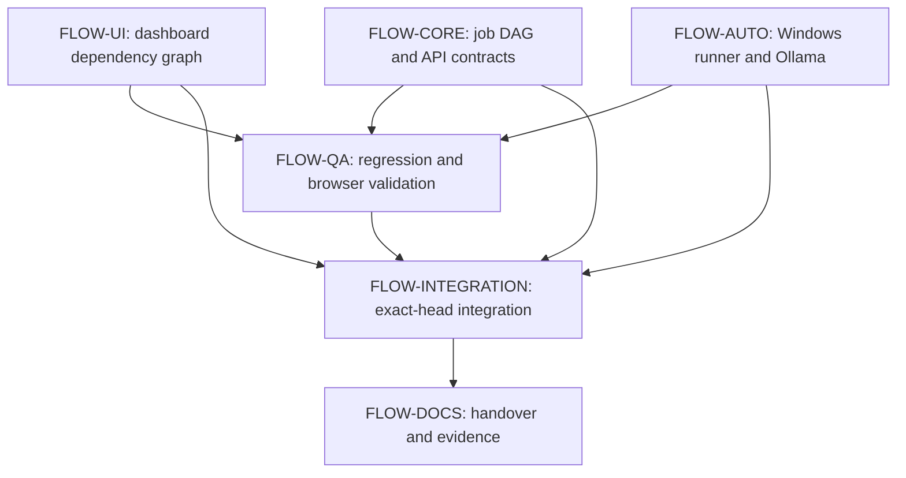

# NEXUS STUDIO PRO — Multi-flow execution plan

**Plan version:** v0.1  
**Date:** 2026-11-20  
**Repository:** https://github.com/justinhblee-prog/shorts  
**Coordination principle:** independent work proceeds on isolated branches; shared contracts and integration are serialized.  
**Truth rule:** a lane is `ACTIVE` only while a concrete tool/runner operation is executing. A defined lane is not evidence of a background agent.

## 1. Execution model

The work is divided into five delivery lanes plus one integration gate. Each lane owns a disjoint set of files and produces a reviewable change. The lanes can be developed independently; the integration gate combines them after focused validation.

| Lane | Ownership | Primary output | Current checkpoint | Next executable task |
|---|---|---|---|---|
| FLOW-UI | `frontend/**`, frontend tests in `backend/tests/test_frontend.py` | Real dashboard screens, responsive states, accessible interactions, browser evidence | Existing 19-module dashboard and development-job monitor passed hosted Chromium smoke in run 44592757768 | Show actual job dependency graph and group work by UI/Core/QA/Automation/Docs lane |
| FLOW-CORE | `backend/**`, database contracts and backend tests | Durable job graph, worker lease/fencing, APIs, security and provider adapters | Development job DAG, worker registry, event history and audited quarantine recovery exist | Verify persistence/recovery invariants and API contract gaps; keep shared schemas serialized |
| FLOW-AUTO | `.github/workflows/**`, runner scripts and runner contract tests | Safe Windows/Ollama execution, persistent tooling, exact Draft PR evidence | PR #409 moves backend/Aider venvs outside the clean worktree; hosted run 44592757768 passed | Windows runner preflight and two-run LocalAppData SQLite persistence proof |
| FLOW-QA | `backend/tests/**`, `scripts/**`, CI validation definitions | Regression coverage, Chromium smoke, exact-head evidence | Hosted suite and both dashboard/recovery browser smoke tests passed for PR #409 | Add UI dependency-graph assertions and preserve exact-head CI gates |
| FLOW-DOCS | `docs/**`, handover and operator guidance | Current decisions, status, validation boundaries, runbooks | PR #410 adds mainline-based handover and current workstream notes | Keep lane status and evidence synchronized with merged/verified heads |
| FLOW-INTEGRATION | Contract docs and coordinated integration only | Compatible integrated candidate, full test run, review-ready Draft PR | PR #407 integrated dashboard/recovery candidate; PR #409 worker fix is based on that candidate | Integrate UI/automation increments in dependency order; no automatic merge or deploy |

## 2. Dependency graph

UI, Core, Automation, and Docs can work on disjoint files concurrently. QA follows each lane's output and can run focused checks independently. Integration waits only for changes that share contracts or files; it does not block independent lane work.

## 3. File ownership and conflict rules

1. UI owns `frontend/**` and frontend-specific assertions only. It does not change backend routes, DB schemas, or worker behavior.
2. Core owns `backend/**` and backend API/schema contracts. It does not redesign dashboard layout.
3. Automation owns `.github/workflows/**` and runner contract tests. It does not change executor security policy without a Core review.
4. QA may add tests and smoke scripts in its owned test paths. If a test requires a product source change, the owning lane makes that change.
5. Docs owns `docs/**` and handover content. It records evidence but does not promote unverified behavior to complete.
6. One active writer per file. Shared API contracts, migrations, workflow permissions, and release gates require an integration decision before implementation.
7. Branches remain isolated Draft PRs. No automatic merge, deployment, secret rotation, public publishing, destructive migration, or paid-provider operation.

## 4. Completion contract

A lane item is complete only when all applicable conditions hold:

- A meaningful source or documentation diff exists; a no-op run is not completion.
- Focused tests pass and the exact tested commit SHA is recorded.
- UI work includes a browser-visible result and desktop/mobile checks.
- Backend work includes API/schema regression tests and security checks.
- Automation work includes workflow-contract tests; Windows/Ollama claims require the actual trusted Windows runner.
- QA evidence distinguishes hosted fixtures from real provider/runtime tests.
- Docs include changed decisions, exact PR/commit/run links, unresolved risks, and next dependency.
- The PR remains Draft until explicitly approved. CI passing never authorizes merge or production release.

## 5. Current queue and next order

| Order | Item | Lane | Status | Acceptance evidence |
|---:|---|---|---|---|
| 1 | Worker virtual environments outside clean checkout | FLOW-AUTO | Hosted PASS — PR #409 | Exact-head run 44592757768; Windows still unverified |
| 2 | Dashboard dependency graph and workstream grouping | FLOW-UI | Ready to implement | API-backed dependencies, lane grouping, no fabricated status, responsive browser smoke |
| 3 | Dependency/API contract regression for UI graph | FLOW-QA | Queued behind UI diff | Frontend assertions + analytics/recovery Chromium smoke |
| 4 | Windows runner and LocalAppData persistence | FLOW-AUTO | Blocked on trusted runner execution | Two separate workflow runs show same DB path and durable job/event state |
| 5 | Real local-model cycle | FLOW-CORE + FLOW-AUTO | Blocked on runner preflight | Ollama-generated scoped diff, passing validation, exact Draft PR artifact, dependency advancement |
| 6 | Integrated release-readiness review | FLOW-INTEGRATION + FLOW-DOCS | Waiting on 2–5 | Exact-head CI, reviewed diff, explicit live-test boundaries |

## 6. Current verified evidence

- PR #407 exact head `77333d264a123d80c87e6ca13f1edfc0282be06a`: 880 backend tests, repository validation, frontend syntax, analytics Chromium smoke and audited recovery Chromium smoke passed in run [44589059999](https://github.com/justinhblee-prog/shorts/actions/runs/44589059999). PR remains Draft/unmerged.
- PR #409 exact head `4d7286a7a4472736c0c037a34cff36743c54ae69`: workflow validation and both Chromium smoke suites passed in run [44592757768](https://github.com/justinhblee-prog/shorts/actions/runs/44592757768). Artifact [14564576167](https://github.com/justinhblee-prog/shorts/actions/runs/44592757768/artifacts/14564576167).
- PR #410 is the mainline-based handover documentation update: https://github.com/justinhblee-prog/shorts/pull/410.
- Hosted Linux CI does not verify the Windows self-hosted runner, persistent LocalAppData behavior, live Ollama generation, OAuth, real media rendering, or provider publishing.

## 7. Execution status protocol

Use only these states:

- `READY`: scoped and can be started.
- `ACTIVE`: an actual tool/runner operation is currently executing.
- `BLOCKED`: requires a named external capability or operator action.
- `VERIFYING`: code exists and exact validation is running.
- `PASS`: exact commit and validation evidence recorded.
- `NOT STARTED`: no implementation attempt yet.

Do not label several lanes as simultaneously ACTIVE unless separate operations are actually running. The chat does not continue background execution while idle; scheduled work requires an enabled workflow and an online trusted runner.
