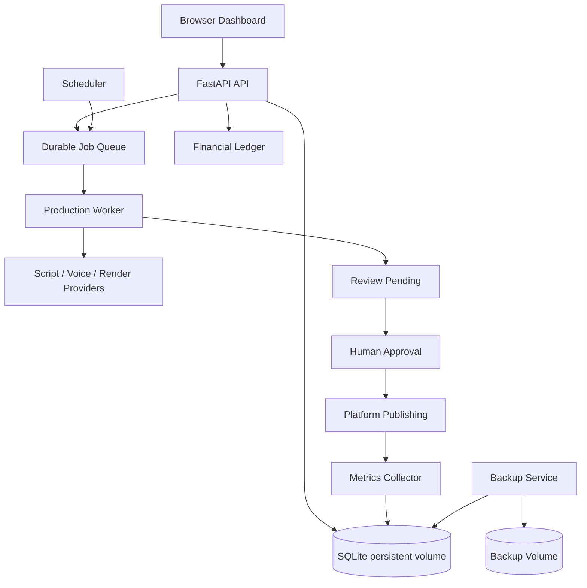

# NEXUS STUDIO PRO — 시스템 및 UX 설계 인수인계

- 문서 버전: v0.1
- 기준일: 2026-11-20
- 저장소: https://github.com/justinhblee-prog/shorts

## 1. 아키텍처 개요

현재 저장소 기준 시스템은 FastAPI 기반 API, SQLite 영속 데이터, Worker, Scheduler, Metrics Collector, Docker Compose 및 단일 페이지 프런트엔드로 구성됩니다. 현재 구조는 단일 호스트 SQLite 운영 기준선이며, 멀티호스트 고가용성 구조나 PostgreSQL 운영 전환이 완료된 것으로 간주하지 않습니다.

실제 코드의 서비스 구성과 endpoint는 현재 branch/commit에서 다시 확인해야 합니다. 위 다이어그램은 개념적 책임 관계를 나타내며, 모든 화살표가 실환경에서 검증되었다는 의미는 아닙니다.

## 2. 주요 구성요소

### Frontend
- `frontend/index.html`: 단일 페이지 업무 영역과 폼/컨테이너.
- `frontend/app.js`: API 호출, 화면 렌더링, 폼 이벤트, 상태 표시.
- `frontend/cyber-magic.css` 및 관련 CSS: 시각 디자인과 반응형 스타일.
- UI 변경은 기존 DOM ID, 데이터 속성, API 계약 및 키보드 접근성을 보존해야 합니다.

### Backend API
- `backend/app.py`: FastAPI 애플리케이션 및 endpoint 연결.
- 도메인 모듈은 브랜드, 트렌드, 경쟁 분석, 기회 평가, 제작, 검수, 게시, 재무, 분석, 예약, 정책 등의 책임을 분리합니다.
- `backend/README.md`가 endpoint·환경변수·운영 절차의 기술 참조입니다.

### Queue / Worker / Scheduler
- Durable queue는 작업 상태·idempotency·이벤트 이력·worker registry를 유지합니다.
- Worker는 작업 claim 시 lease/fencing 정보를 사용하며 heartbeat/완료/실패를 조건부 처리합니다.
- Scheduler는 예약 occurrence를 안전하게 예약하고 outbox/queue로 전달합니다.
- 오래된 worker나 collector의 지연 응답은 현재 lease token 소유권 확인 없이 영속 상태를 변경해서는 안 됩니다.

### Providers / Publishing
- 제작 공급자는 script, voice, render 단계의 provider-neutral HTTP 계약을 사용합니다.
- 실제 공급자 endpoint와 credential은 환경변수/비밀 저장소로 주입합니다.
- 제작 완료는 review_pending으로 이동하며, 사람의 승인 전 공개 게시를 허용하지 않습니다.
- YouTube 업로드는 현재 구현 정책상 private로 고정되어 있습니다.
- TikTok 기능은 실제 개발자 앱·계정 권한·동의·플랫폼 정책을 확인해야 합니다.

### Persistence / Backup
- 현재 기본 영속 저장소는 SQLite이며 Compose volume을 공유합니다.
- 백업은 별도 Docker volume을 사용하고 체크섬·무결성 검사·보존 정책·명시적 복원 확인을 둡니다.
- AES-256-GCM 암호화 옵션과 ClamAV 미디어 검사 옵션이 문서화되어 있습니다.
- 백업 volume이 동일 호스트에만 있으면 재해 복구가 되지 않으므로 오프사이트 복제가 필요합니다.
- 암호화 키는 백업 아카이브와 분리 보관해야 합니다.

## 3. 데이터 및 업무 흐름

1. 운영자가 브랜드·시장·언어·플랫폼·주제를 선택해 제작 또는 예약 작업을 생성합니다.
2. API가 입력·브랜드 상태·정책 조건을 확인하고 durable queue에 작업을 등록합니다.
3. Worker가 작업을 claim하고 lease를 갱신하면서 provider 단계별 결과를 기록합니다.
4. 성공 결과는 review_pending으로 이동하며 스크립트·오디오·렌더 아티팩트의 참조를 보관합니다.
5. 검수자는 결과물·정책 증빙을 확인하고 승인/반려/수정 요청을 기록합니다.
6. 승인된 작업만 게시 어댑터의 사전 조건을 만족합니다. 업로드 후 플랫폼 응답과 상태를 추적합니다.
7. Metrics Collector는 실제 제공되는 지표만 저장하며 수집 상태와 커버리지를 별도로 기록합니다.
8. 재무 장부는 출처가 있는 실제 거래를 기록합니다. 조회수에서 수익을 추정해 실제 장부를 채우지 않습니다.
9. 성과 분석은 스냅샷·코호트·holdout을 구분하며 상관관계를 인과관계로 표현하지 않습니다.

## 4. UI 정보 구조 및 설계 원칙

- Studio: 제작 작업 생성 및 브랜드 운영.
- Intelligence: 트렌드·경쟁 채널·기회 점수·추천 근거.
- Review: 검수 큐, 아티팩트 미리보기, 승인 기록, 계정/게시 상태.
- Operations: 예약·큐·재무 장부·성과 인사이트·연동 사전 점검.

시각 방향은 프리미엄 다크 운영 콘솔이며, 기존의 네이비/퍼플 계열 디자인을 유지합니다. 디자인 변경 시:
- 화면의 정보 우선순위와 작업 흐름을 먼저 정의합니다.
- 데스크톱과 320px 모바일을 포함한 반응형 동작을 확인합니다.
- 긴 데이터 목록은 페이지네이션/가상화 등으로 사용성을 확보합니다.
- 로딩·빈 상태·부분 실패·권한 거부·오프라인 상태를 구분합니다.
- 버튼은 실제 동작을 제공해야 하며 시각적 장식용 동작을 성공으로 표시하지 않습니다.
- 접근 가능한 이름, landmark, focus-visible, keyboard traversal, live status를 유지합니다.

## 5. API 및 모듈 경계

- UI lane은 `frontend/**` 및 UI 테스트를 소유합니다.
- Core lane은 `backend/**`, DB schema/migration, worker/provider runtime을 소유합니다.
- Policy lane은 policy engine과 승인/정책 테스트를 소유합니다.
- Integration lane은 API 계약, 교차 계층 테스트, readiness 문서를 조정합니다.
- 한 파일에 동시에 두 작업자가 쓰지 않습니다. 공유 계약 변경은 먼저 문서화하고 순차 반영합니다.
- API 응답 형태가 없으면 UI에서 mock 성공 상태를 만들지 말고 Core 계약 작업으로 등록합니다.

## 6. 보안·정책 설계

- Review/API 인증은 구성 누락 시 거부하는 fail-closed 원칙.
- 개인별 credential을 사용할 경우 명시적 role map을 구성합니다.
- OAuth refresh token, API key, 암호화 키, review token은 저장소·로그·문서 예시에 실제 값을 넣지 않습니다.
- 외부 URL은 HTTPS·credential 부재·허용 host 등 계층별 검증을 적용합니다.
- 사용자 제공/생성 미디어는 크기·파일 형식·악성코드 검사·출처·권리 증빙을 확인합니다.
- 공개 게시와 재무 조정은 자동화 테스트 통과와 별개의 사람 승인/운영 절차를 둡니다.

## 7. 배포 및 확장 한계

현재 저장소는 Docker Compose로 API, worker, scheduler 및 collector/backup 관련 서비스를 실행하는 단일 호스트 기준선을 제공합니다. 다음은 운영 확장 전 해결할 과제입니다.
- SQLite 단일 호스트 제약과 PostgreSQL 전환/마이그레이션 계획
- 다중 인스턴스 간 queue/lease/lock의 운영 검증
- secret manager, TLS reverse proxy, trusted proxy 설정
- 백업 오프사이트 복제 및 실제 복원 훈련
- 로그·메트릭·알림·장애 대응 체계
- 공급자 rate limit, 비용 제한, 재시도 및 circuit breaker
- 고객별 테넌트 격리 및 데이터 접근 정책

## 8. 설계 변경 체크리스트

- [ ] 기존 API/DB 호환성 및 migration 순서 확인
- [ ] 권한·감사·개인정보 영향 확인
- [ ] UI 로딩/성공/빈 상태/실패 상태 확인
- [ ] Worker lease 및 중복 실행 안전성 확인
- [ ] idempotency 및 외부 작업의 모호한 결과 처리 확인
- [ ] 테스트와 최신 head CI 증거 확보
- [ ] 브라우저 스크린샷/상호작용 검증
- [ ] 관련 문서와 인수인계 인덱스 업데이트

## 변경 이력

- 2026-11-20: 저장소 README, backend README, frontend/index.html 및 orchestration 문서를 기준으로 최초 작성. 개념도와 실환경 검증 상태를 명확히 구분.
